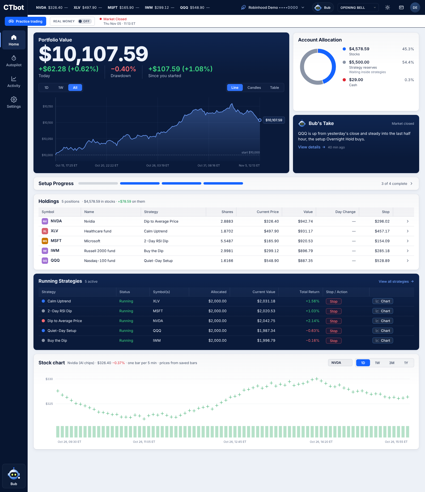
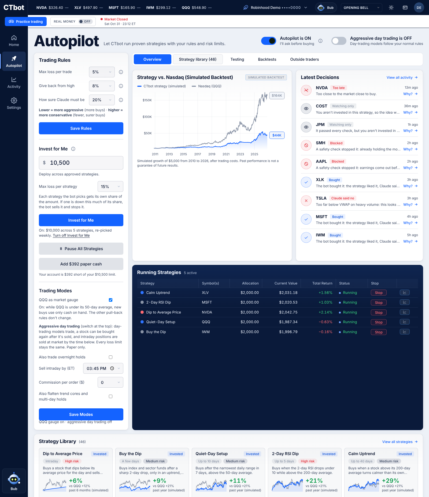
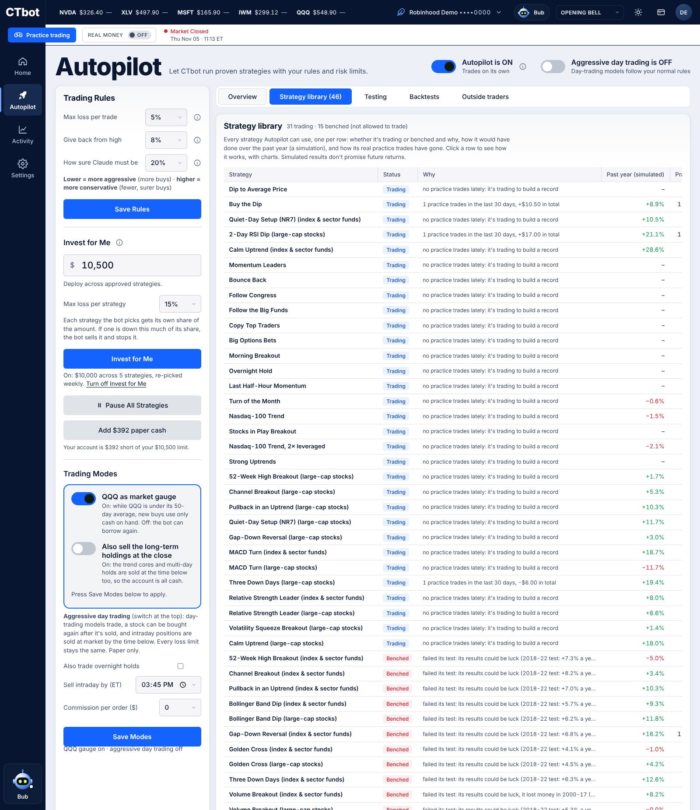
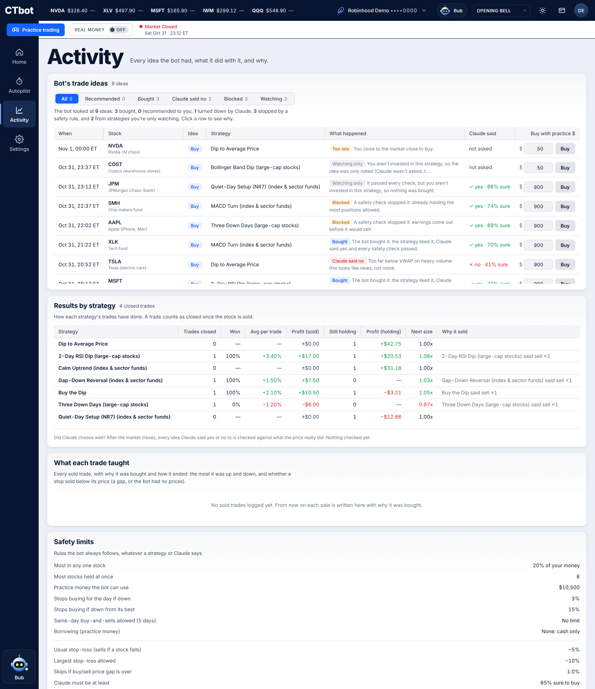
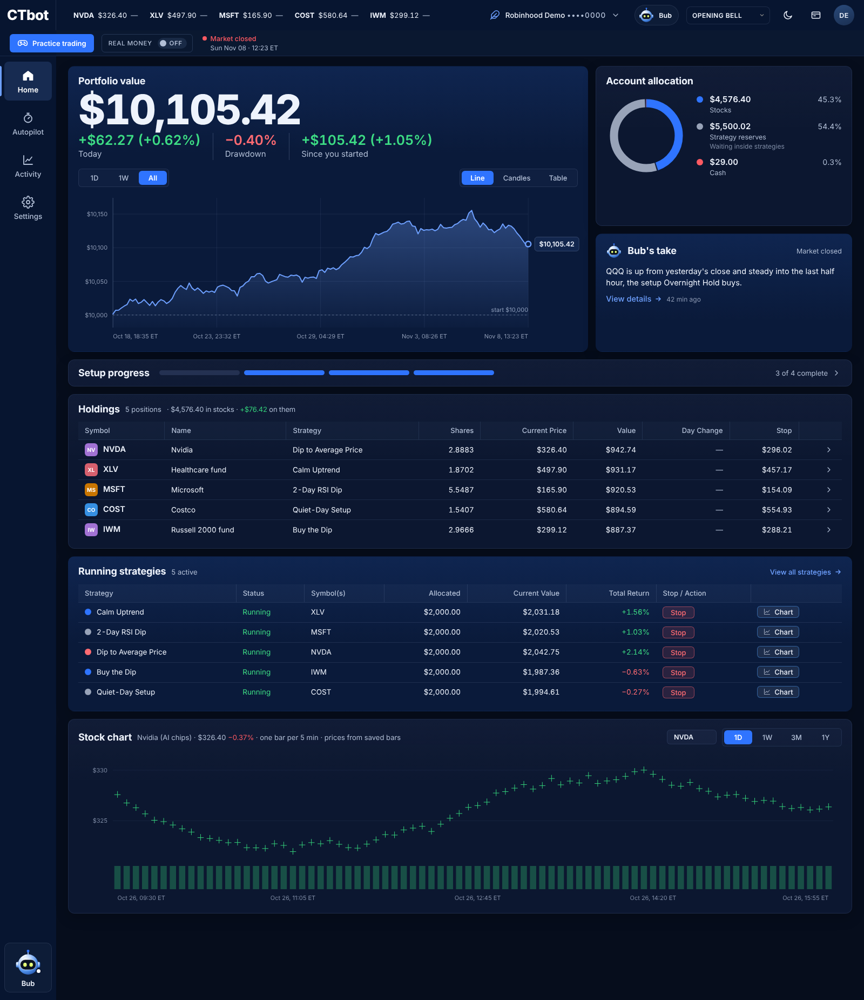
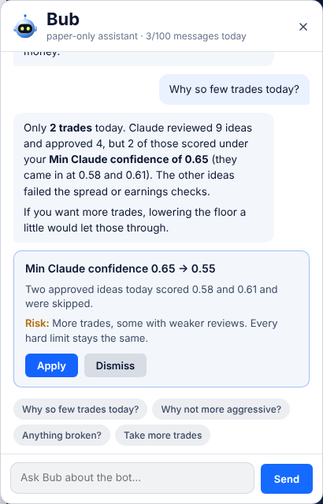

# CTbot · Creature Trading Bot

A paper-trading bot you run on your own computer or a small server. Turn on **Autopilot**, give it
one amount of paper money and three rules, and it picks the strategies, funds them and trades
them for you. CTbot reads live prices from your own Robinhood
account, can ask Claude to review each trade idea, and runs every order through hard risk rules
first.

> **Paper trading only, today.** Every trade is simulated. CTbot reads from Robinhood but never
> sends it an order: the real-money code is unfinished and disabled. Read the
> [risk notice](DISCLAIMER.md) before you use it, with paper or real accounts. Not investment
> advice. All risk is yours.

Free and open source ([MIT](LICENSE)) by [Rare Creatures](https://rarecreatures.app). No accounts,
no servers of ours, no tracking: your keys and data stay on your machine (or on a server you rent
yourself, see [Run it on a server](#run-it-on-a-server-hetzner-or-any-ubuntu-vm)).

**New: Opening Bell.** The dashboard has a new default look: light and blue, a live ticker tape,
big numbers and a left rail (bottom bar on a phone), in light or dark. The older design is still a
click away in the style menu.

<p align="center">
  
</p>

### Autopilot: the bot picks, funds and trades the strategies for you

| Set three rules, flip it on, give it an amount | Every strategy it may use, and why |
|---|---|
|  |  |
| **Activity: every idea, what happened and why** | **Dark mode** |
|  |  |

<sub>Screenshots: Opening Bell with made-up demo data (generated prices and a paper account; no real account). Every number comes from those made-up prices, so none of it is a real result or a promise of anything.</sub>

**Want it running all day like mine, with phone alerts?** Follow
**[Set up CTbot exactly like mine](docs/SETUP.md)**: a ~$7/month server, a private dashboard on
your Mac and phone over Tailscale, ntfy phone messages, and Autopilot investing for you, step by
step.

## What you get

- **A dashboard** at `http://127.0.0.1:8787` (or privately on your phone, see
  [SETUP.md](docs/SETUP.md)), in the Opening Bell style by default, light or dark:
  - **Home**: portfolio value and its chart, account allocation, Bub's take on the market, a
    4-step setup checklist, holdings (with each stop), running strategies and a stock chart.
  - **Autopilot**: switch it on and set three rules: max loss per trade, how much of a run-up to
    give back before selling, and how sure Claude must be before a buy. CTbot then picks trades
    from every strategy by itself, with trailing stops and no fixed profit cap. **Invest for Me**
    takes one dollar amount, picks and funds the strategies itself, re-picks weekly and tops them
    up as cash frees. It learns from its own paper record: each closed trade gets a post-mortem
    (`data/trade_log.jsonl`), a strategy's size grows or shrinks with its last 30 days of results,
    a strategy losing over 10+ trades is benched, and the account stops borrowing after a bad day,
    a drawdown or a QQQ downtrend. Its sections: *Overview* (rules, decisions, what's running),
    *Strategy library* (every strategy, trading or benched and why), *Testing* (crash test back to
    1999, a no-hindsight walk-forward test, the comparison books), *Backtests* (growth of $5,000
    since 2010, the leaderboard) and *Outside traders*. Two **trading mode** switches sit there
    too: QQQ as the market gauge (on by default; QQQ below its average pulls the account back) and
    aggressive day trading (off by default; more same-day trades, all sold before the close).
  - **Activity**: the bot's trade ideas and what happened to each, results by strategy, what each
    trade taught, safety limits, trade history, the watchlist and a live log.
  - **Settings**: add your API keys, connect Robinhood, run a health check, review Bub's changes.
- **Strategies** you can run alone or together: Nasdaq-100 trend (plain and 2× leveraged), buy the
  dip on index funds, turn of the month, and same-day breakout models. Each is described, with its
  risk level, on the Autopilot tab.
- **Hard limits** no model can override: per-position size, total money, daily loss pause,
  drawdown stop, bid/ask spread and liquidity checks, no holding through earnings, SEC 8-K red
  flags, and your own max loss and take-profit per strategy. Optional rules from the trading skill
  packs (`.claude/skills/`): risk-per-trade sizing, total open risk, entries per day, minimum
  reward/risk, half off at 1R, a VWAP entry gate and a bear-market gate (see `.env.example`).

## Install on your computer

About ten minutes. You need:

- **macOS or Linux** (Ubuntu 24.04 is what the server setup below uses). Windows isn't supported;
  WSL2 with Ubuntu may work but is untested.
- **Python 3.11 or newer** and **git**. macOS: `brew install python git` (the built-in `python3`
  is too old). Ubuntu/Debian: `sudo apt install git python3-venv`.
- A **Robinhood account with agent (MCP) access**, for live prices (read-only; CTbot never sends
  it an order).
- Optional: an [Anthropic API key](https://console.anthropic.com/) for Claude's trade reviews and
  Bub, and an OpenAI key as Bub's backup.

```bash
git clone https://github.com/HarrisonFischberg/ctbot.git
cd ctbot
python3 -m venv .venv
.venv/bin/pip install -e '.[dev]'
.venv/bin/pytest -q                    # every test should pass
cp .env.example .env && chmod 600 .env
```

Open `.env` in any editor and change two lines (everything else can stay as it is):

```bash
MARKET_DATA=robinhood   # live prices; the default "csv" reads bar files from data/bars, and none ship
ENTRY_MODE=auto         # buys go through on their own; "manual" makes each one wait for your click
```

Then sign in to Robinhood once (it opens your browser; the token stays in `~/.ctbot/`, mode 600)
and start the bot:

```bash
.venv/bin/ctbot-robinhood-login        # prints a test SPY quote when it works
./run_ctbot.sh                         # dashboard + paper bot; Ctrl+C stops both
```

The dashboard opens at `http://127.0.0.1:8787`. Go to **Settings**, paste your Anthropic key
(or put `ANTHROPIC_API_KEY` in `.env`) and press **Run check**. Then open **Autopilot**, set your
three rules, flip it on and press **Invest for Me** (or invest in one strategy from the library).
The bot trades paper money during US market hours (9:30 to 16:00 ET, weekdays) for as long as
`./run_ctbot.sh` runs, and sits idle outside them.

Starting paper money and limits come from `.env`: `STARTING_CAPITAL` and `MAX_TRADING_CAPITAL`
default to $250, so raise both (for example to `10000`) to try it with a bigger paper account.
`.env.example` explains every other setting. A Mac can also start the bot at login, see
[Start at login](#start-at-login-macos-optional).

## Run it on a server (Hetzner or any Ubuntu VM)

A laptop sleeps, travels and loses Wi-Fi. For a bot that trades every session, run it on a small
Linux server: a Hetzner CX23 (~$7/month) or a 2 GB DigitalOcean droplet (~$12) works. The full
walkthrough with Tailscale and phone alerts is **[docs/SETUP.md](docs/SETUP.md)**; every file and
timer is in [docs/CLOUD_HOSTING.md](docs/CLOUD_HOSTING.md). The short version:

1. **Create the server**: Ubuntu 24.04, 2 GB of RAM, your computer's SSH key, password login off.
2. **Install CTbot** (as root). Use your fork's URL instead if you want to choose when updates
   arrive:

   ```bash
   ssh root@<server-ip>
   curl -fsSLO https://raw.githubusercontent.com/HarrisonFischberg/ctbot/main/deploy/setup-server.sh
   bash setup-server.sh
   ```

   It installs packages, creates a `ctbot` user, turns on a firewall (SSH only), clones the repo,
   installs the systemd services and stops with what is still missing. That is expected.
3. **Write `.env`**, the same two lines as above plus your keys (`ANTHROPIC_API_KEY`, and
   optionally `HEARTBEAT_URL` and `NOTIFY_URL` for alerts, see below):

   ```bash
   cd /home/ctbot/ctbot && sudo -u ctbot cp .env.example .env && chmod 600 .env && nano .env
   ```

4. **Sign in to Robinhood** through an SSH tunnel, because the sign-in calls back to
   `localhost:8765`. From your computer:

   ```bash
   ssh -L 8765:localhost:8765 root@<server-ip>
   sudo -u ctbot -H bash -c 'cd ~/ctbot && .venv/bin/ctbot-robinhood-login'
   ```

   Open the link it prints in your computer's browser.
5. **Start it**: `bash /home/ctbot/ctbot/deploy/setup-server.sh` again. This time it starts the
   bot, the dashboard and the timers, and prints a health check.
6. **Open the dashboard**. It listens only on the server's loopback, so either tunnel to it
   (`ssh -N -L 8787:127.0.0.1:8787 root@<server-ip>`, then `http://127.0.0.1:8787`) or run
   `bash /home/ctbot/ctbot/deploy/tailscale.sh` on the server to get a private
   `https://ctbot.<tailnet>.ts.net` address for your computer and phone (it can also close public
   SSH afterwards).

After that:

- **Updates deploy themselves**: `ctbot-update.timer` pulls `main` and restarts the bot at 08:45
  or 16:20 ET on the next weekday, never while the market is open.
- **Alerts** (optional): `ctbot-watchdog` runs every minute. With `HEARTBEAT_URL` set to a
  [Healthchecks.io](https://healthchecks.io) ping URL you are alerted when the server or bot stops;
  with `NOTIFY_URL` set to a long, random [ntfy](https://ntfy.sh) topic you get phone updates on
  the trading day and a message when something breaks.
- **Logs**: `journalctl -u ctbot-paper -f`. **Pause all buying**: `touch /home/ctbot/ctbot/data/HALT`.
- **Paper only**: the services pin `LIVE_TRADING_ENABLED=false`, whatever `.env` says.

Run only one bot per paper account: once the server trades, stop the one on your computer (on a
Mac with autostart, `scripts/autostart.sh uninstall`).

### What runs, and when

| What | When | Where it lives |
|---|---|---|
| Paper bot, main book | every 5 minutes in market hours; stops checked every 30 s | `ctbot-paper`, `data/` |
| Comparison books (one setting changed each) | right after each main cycle, same data and Claude verdicts | `config/variants.toml`, `data/variants/<name>/` |
| Dashboard | always | `ctbot-dashboard`, `127.0.0.1:8787` |
| Watchdog: heartbeat ping, phone messages | every minute | `ctbot-watchdog` |
| Research refresh: bar caches, idea scoring, preflight, day plan, reconciliation | weekdays 08:15 and 16:30 ET | `scripts/c2_track_weekly.sh` |
| Auto-update from `main` (server only) | weekdays 08:45 and 16:20 ET | `deploy/update.sh` |

The comparison books are how new rules get tried: each starts with $10,000 of paper money and
differs from `base` in one thing (trail, starting stop, Claude's confidence floor, position count,
ideas per cycle, the reviewing model, or the trading-skill rules). Compare them on the Autopilot
page's *Settings test* card or with `.venv/bin/ctbot-variants`. Nothing promotes a book's settings
to the main book by itself.

## Start at login (macOS, optional)

Not needed if the bot runs on a server (and don't run both). To have the dashboard and paper bot start when you log in and come back if they stop:

```bash
scripts/autostart.sh install      # start now, at every login, and after a crash
scripts/autostart.sh status       # running? pid and last exit code
scripts/autostart.sh uninstall    # stop it and turn autostart off
```

Keys must be in the dashboard's **Settings** tab or in `.env`: launchd doesn't read your shell
profile, so a key you only `export` there is invisible to the agent (and an old one in `.env`
gets used instead). The health check names where its Claude key came from when it fails.

It runs the same `./run_ctbot.sh`, paper only (the agent pins `LIVE_TRADING_ENABLED=false`),
without opening a browser tab; output goes to `logs/bot.log`. Stop any `./run_ctbot.sh` you
started by hand before installing, and don't start one while autostart is on, or two bots
would trade the same paper account.

Keeping the Mac awake: the bot doesn't do this itself. Use an app that keeps the Mac awake
during market hours (or macOS Energy settings). Closing a laptop's lid still sleeps it unless it
has power and an external display (clamshell mode).

More commands, including backtests and the research lab: [docs/COMMANDS.md](docs/COMMANDS.md).
How it fits together: [docs/ARCHITECTURE.md](docs/ARCHITECTURE.md).

## Assistant

**Bub**, the little creature at the bottom of the left rail (bottom bar on a phone), answers questions about what
the paper bot is doing and why ("Why so few trades today?", "Anything broken?"), in plain language
with the bot's own numbers, and suggests changes when you ask for them ("Take more trades").

<p align="center"></p>

- **What it reads**: the same snapshot the dashboard shows, plus all of today's trade ideas
  (`data/ideas.jsonl`) and today's paper log, counted by outcome and reason, and which tab, stock
  or idea you're looking at. Never your keys: `.env` and `~/.ctbot/` are not read into it. Your
  question and that summary go to Anthropic with your key, as trade reviews do.
- **What it can change**, each within bounds written in `src/ctbot/tuning.py` and
  `src/ctbot/assistant/actions.py`: the risk and ensemble knobs (`MIN_CLAUDE_CONFIDENCE`,
  `MIN_LONG_SCORE`, `MIN_AGREEING_STRATEGIES`, `MAX_CANDIDATES_PER_CYCLE`, `MAX_OPEN_POSITIONS`,
  the review budgets, `MAX_SPREAD_PCT`, `NO_ENTRIES_LAST_MINUTES`, `MAX_POSITION_PCT`,
  `ENTRY_MODE`), a strategy's shadow/trade mode, investing in or stopping a strategy, and paper
  orders, including approving a recommended idea.
- **Every change needs your click.** Bub only proposes; each suggestion is a card with the
  change, why, and the risk. Nothing happens until you press **Apply**, and the server checks it
  again then. Knob changes go to `~/.ctbot/tuning.json` and reach the running paper bot within
  seconds, no restart.
- **Everything is logged** in `data/assistant_audit.jsonl`: what you asked, what was proposed, the
  value before and after, and whether you applied or dismissed it. Settings → *Assistant
  changes* lists them, each with a one-click **Revert** (orders can't be reverted).
- **Paper only.** No action can turn on live trading, touch the Robinhood account settings, raise
  `MAX_TRADING_CAPITAL`, loosen the loss or stop limits, or allow shorting. It has no Robinhood
  access at all.
- It uses the Anthropic key from the Settings tab, with its own daily cap
  (`MAX_ASSISTANT_MESSAGES_PER_DAY`, default 100) that doesn't use up the trade-review budget.

## What it costs

CTbot is free. Services you connect may charge you:

- **Anthropic API**: billed to your key for each Claude review and each assistant message. The
  bot caps reviews per day (`MAX_CLAUDE_REVIEWS_PER_DAY`) and assistant messages separately
  (`MAX_ASSISTANT_MESSAGES_PER_DAY`). On a small account the review cost can exceed the edge it is
  checking. Strategies that follow a fixed rule never call Claude.
- **Robinhood**: its own fees and rules apply to your account.
- **Collective2** (optional): research data; some strategies there are paid subscriptions.

## Your data

Nothing is sent to us. Keys stay in `.env` or `~/.ctbot` (readable only by your user). Data goes
only from your computer to the services you connect. The dashboard sets no cookies. Details,
and how to delete everything: [PRIVACY.md](PRIVACY.md).

## Safety design

- Paper and real-money code run as separate programs. A paper process cannot even import the
  real-money module, and tests fail if anything else names an order-placing tool.
- Real money would need three separate settings to agree, plus an exact confirmation phrase, and
  would refuse any account except the one you name by full number and nickname. That code is not
  finished and is not enabled.
- The dashboard listens only on your computer and rejects requests from other websites.

## Disclaimer

CTbot is provided "as is", without warranty of any kind. It is not investment, financial, legal
or tax advice, and Rare Creatures LLC is not a broker or investment adviser. Trading involves
risk of loss, including all of the money you invest. Simulated and past performance do not
predict future results. AI reviews can be wrong.

While you can connect both paper and real brokerage accounts through Robinhood and MCP, and
anyone can modify this open-source code, **all risk from using it is yours**: every trade,
setting, change and loss. You must be 18 or older, and you are responsible for following the
terms of every service you connect and the laws that apply to you.

CTbot is not affiliated with, endorsed by or sponsored by Robinhood Markets, Inc., Anthropic or
Collective2. Their names are used only to describe what CTbot connects to. Full text:
[DISCLAIMER.md](DISCLAIMER.md) · [TERMS.md](TERMS.md) · [PRIVACY.md](PRIVACY.md) ·
[SECURITY.md](SECURITY.md).

## License and contact

[MIT](LICENSE) © 2026 Rare Creatures LLC, Colorado, United States · hello@rarecreatures.app ·
Issues and pull requests welcome.
