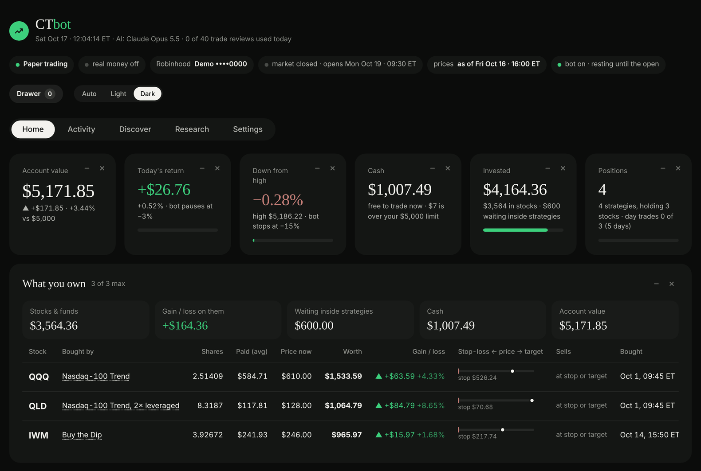
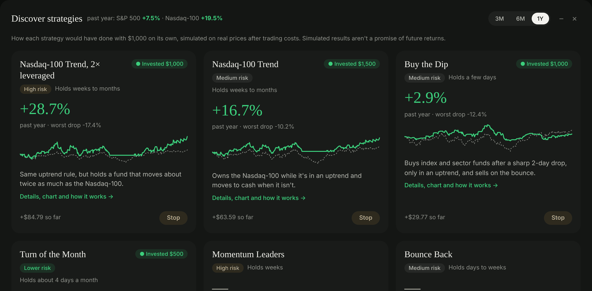
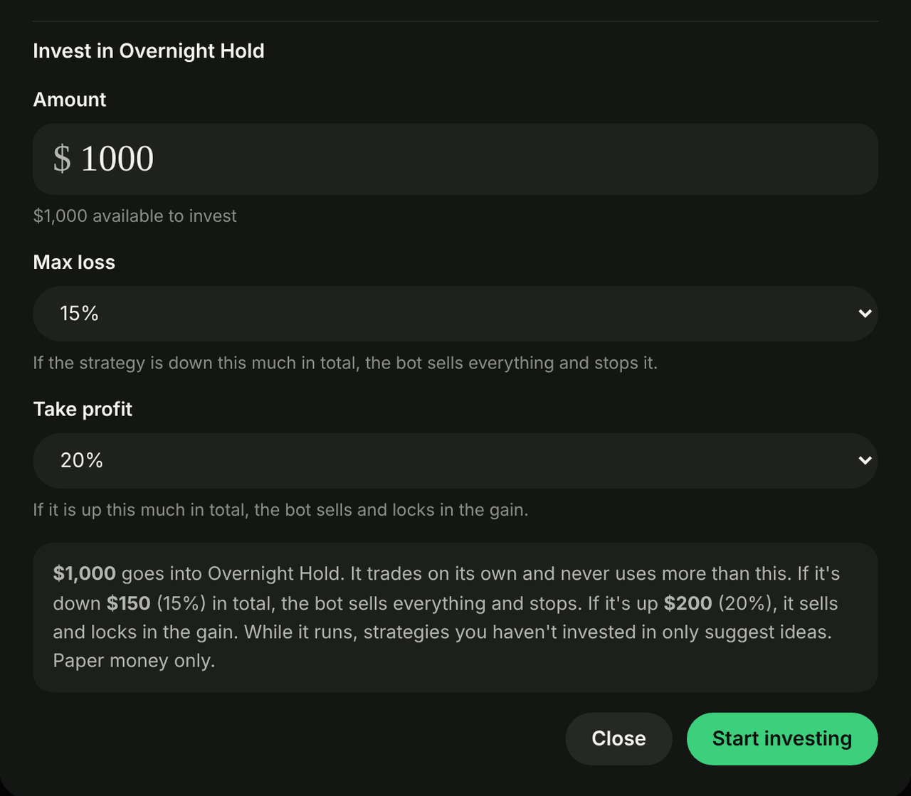
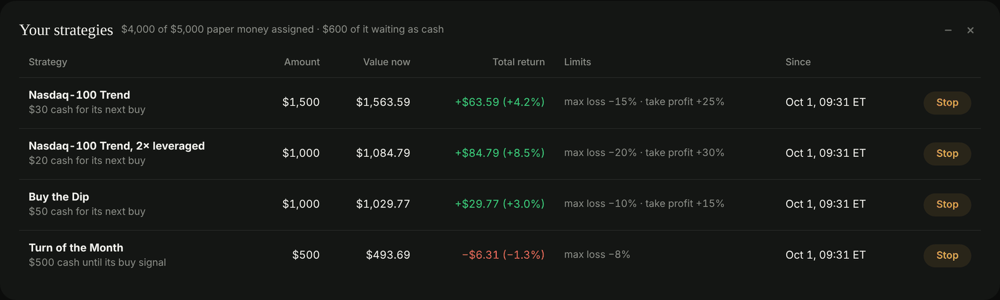
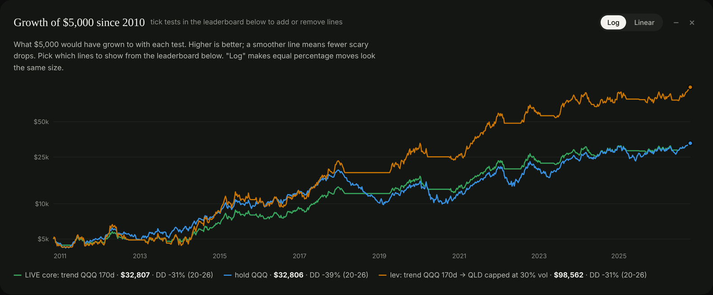

# CTbot · Creature Trading Bot

A trading bot you run on your own computer. Pick a strategy, give it an amount of paper money, set
a max loss and a take-profit, and let it trade. CTbot reads live prices from your own Robinhood
account, can ask Claude to review each trade idea, and runs every order through hard risk rules
first.

> **Paper trading only, today.** Every trade is simulated. CTbot reads from Robinhood but never
> sends it an order: the real-money code is unfinished and disabled. Read the
> [risk notice](DISCLAIMER.md) before you use it, with paper or real accounts. Not investment
> advice. All risk is yours.

Free and open source ([MIT](LICENSE)) by [Rare Creatures](https://rarecreatures.app). No accounts,
no servers, no tracking: your keys and data stay on your machine.

<p align="center">
  
</p>

| Discover: strategies with simulated 3/6/12-month returns | Invest: amount, max loss, take-profit |
|---|---|
|  |  |
| **Your strategies: what each one holds and returns** | **Research: backtests since 2010** |
|  |  |

<sub>Screenshots: dark mode with made-up demo data (generated prices and a paper account; no real account). Every number comes from those made-up prices, so none of it is a real result or a promise of anything.</sub>

## What you get

- **A local dashboard** at `http://127.0.0.1:8787`, in light or dark:
  - **Home**: account value, what you own (with each stop-loss), a 4-step setup checklist, a
    portfolio value chart, a stock chart and your strategies.
  - **Activity**: the bot's trade ideas, results by strategy, safety limits, a watchlist, order
    history and a live log.
  - **Discover**: every strategy in plain English, with simulated returns over the past 3, 6 and 12
    months next to the S&P 500. Press **Invest** to start one.
  - **Research**: every strategy's paper record, growth of $5,000 since 2010, a crash test back to
    1999, a no-hindsight (walk-forward) test and the backtest leaderboard.
  - **Settings**: add your API keys, connect Robinhood, run a health check.
- **Strategies** you can run alone or together: Nasdaq-100 trend (plain and 2× leveraged), buy the
  dip on index funds, turn of the month, and same-day breakout models. Each is described, with its
  risk level, on the Discover tab.
- **Hard limits** no model can override: per-position size, total money, daily loss pause,
  drawdown stop, day-trade count, bid/ask spread and liquidity checks, no holding through earnings,
  and your own max loss and take-profit per strategy.

## Quick start

You need macOS (tested) or Linux (not tested yet), Python 3.11 or newer, a Robinhood account with agent (MCP) access, and
optionally an [Anthropic API key](https://console.anthropic.com/) for Claude reviews.

```bash
git clone https://github.com/HarrisonFischberg/ctbot.git
cd ctbot
python3 -m venv .venv
.venv/bin/pip install -e '.[dev]'
cp .env.example .env              # optional: you can also add keys in the dashboard
.venv/bin/pytest -q               # every test should pass
./run_ctbot.sh                    # dashboard + paper bot; Ctrl+C stops both
```

Open `http://127.0.0.1:8787`, go to **Settings**, add your keys and press **Connect Robinhood**.
Then pick a strategy on **Discover**. The bot trades during US market hours while
`./run_ctbot.sh` is running.

### Start at login (macOS, optional)

To have the dashboard and paper bot start when you log in and come back if they stop:

```bash
scripts/autostart.sh install      # start now, at every login, and after a crash
scripts/autostart.sh status       # running? pid and last exit code
scripts/autostart.sh uninstall    # stop it and turn autostart off
```

Keys must be in the dashboard's **Settings** tab or in `.env`: launchd doesn't read your shell
profile, so a key you only `export` there is invisible to the agent (and an old one in `.env`
gets used instead). The health check names where its Claude key came from when it fails.

It runs the same `./run_ctbot.sh`, paper only (the agent pins `LIVE_TRADING_ENABLED=false`),
without opening a browser tab; output goes to `logs/bot.log`. Stop any `./run_ctbot.sh` you
started by hand before installing, and don't start one while autostart is on, or two bots
would trade the same paper account.

Keeping the Mac awake: the bot already holds `caffeinate -di` while the market is open, so the
Mac doesn't idle-sleep during trading and may sleep after the close. Closing a laptop's lid still
sleeps it unless it has power and an external display (clamshell mode); `caffeinate -s` doesn't
change that, so the agent doesn't add it.

More commands, including backtests and the research lab: [docs/COMMANDS.md](docs/COMMANDS.md).
How it fits together: [docs/ARCHITECTURE.md](docs/ARCHITECTURE.md).

## What it costs

CTbot is free. Services you connect may charge you:

- **Anthropic API**: billed to your key for each Claude review. The bot caps reviews per day
  (`MAX_CLAUDE_REVIEWS_PER_DAY`). On a small account the review cost can exceed the edge it is
  checking. Strategies that follow a fixed rule never call Claude.
- **Robinhood**: its own fees and rules apply to your account.
- **Collective2** (optional): research data; some strategies there are paid subscriptions.

## Your data

Nothing is sent to us. Keys stay in `.env` or `~/.ctbot` (readable only by your user). Data goes
only from your computer to the services you connect. The dashboard sets no cookies. Details,
and how to delete everything: [PRIVACY.md](PRIVACY.md).

## Safety design

- Paper and real-money code run as separate programs. A paper process cannot even import the
  real-money module, and tests fail if anything else names an order-placing tool.
- Real money would need three separate settings to agree, plus an exact confirmation phrase, and
  would refuse any account except the one you name by full number and nickname. That code is not
  finished and is not enabled.
- The dashboard listens only on your computer and rejects requests from other websites.

## Disclaimer

CTbot is provided "as is", without warranty of any kind. It is not investment, financial, legal
or tax advice, and Rare Creatures LLC is not a broker or investment adviser. Trading involves
risk of loss, including all of the money you invest. Simulated and past performance do not
predict future results. AI reviews can be wrong.

While you can connect both paper and real brokerage accounts through Robinhood and MCP, and
anyone can modify this open-source code, **all risk from using it is yours**: every trade,
setting, change and loss. You must be 18 or older, and you are responsible for following the
terms of every service you connect and the laws that apply to you.

CTbot is not affiliated with, endorsed by or sponsored by Robinhood Markets, Inc., Anthropic or
Collective2. Their names are used only to describe what CTbot connects to. Full text:
[DISCLAIMER.md](DISCLAIMER.md) · [TERMS.md](TERMS.md) · [PRIVACY.md](PRIVACY.md) ·
[SECURITY.md](SECURITY.md).

## License and contact

[MIT](LICENSE) © 2026 Rare Creatures LLC, Colorado, United States · hello@rarecreatures.app ·
Issues and pull requests welcome.
