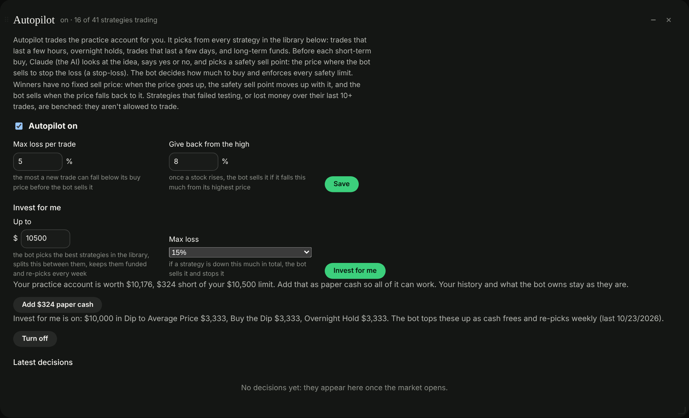
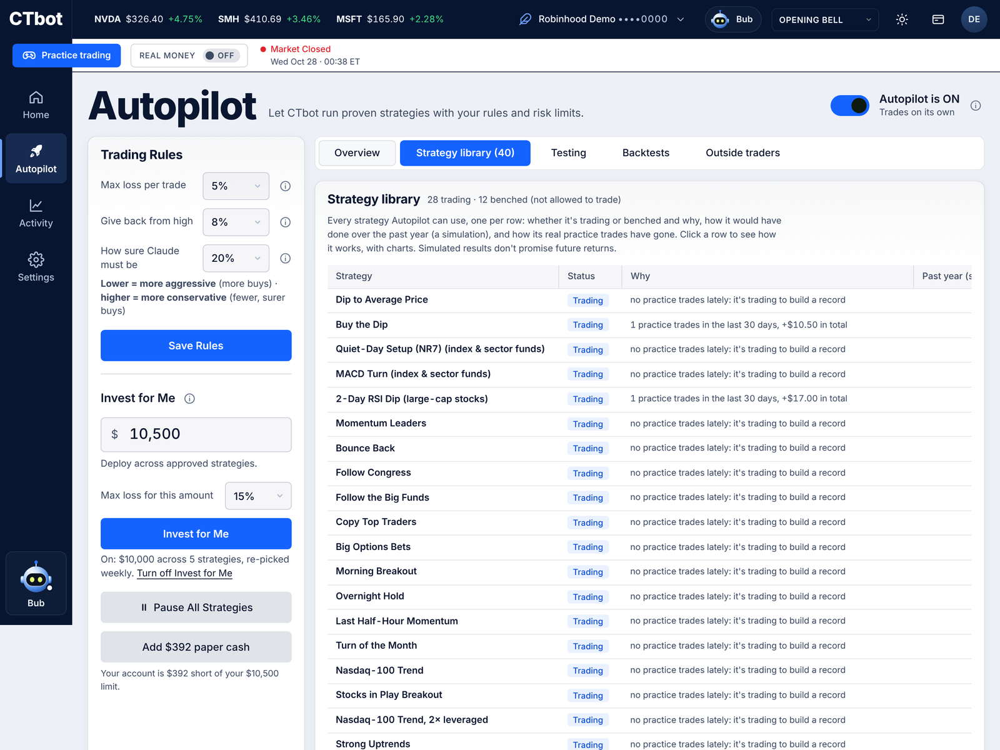
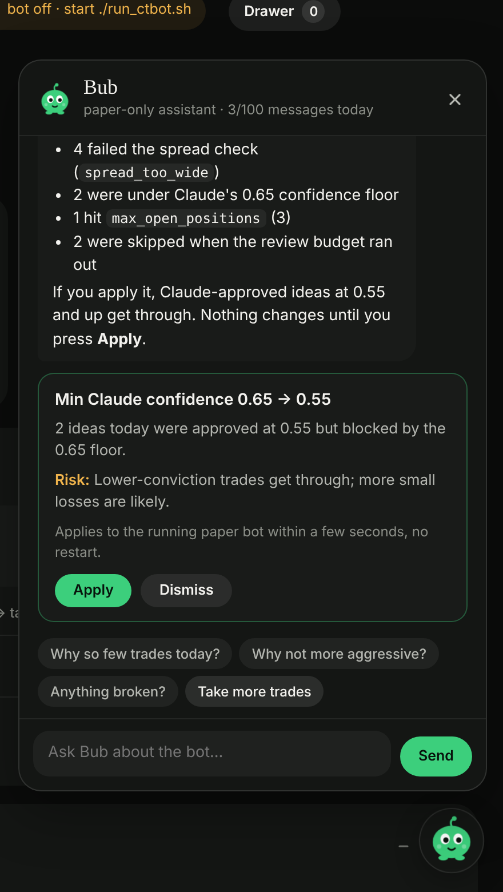

# CTbot · Creature Trading Bot

A trading bot you run on your own computer. Pick a strategy, give it an amount of paper money, set
a max loss and a take-profit, and let it trade. CTbot reads live prices from your own Robinhood
account, can ask Claude to review each trade idea, and runs every order through hard risk rules
first.

> **Paper trading only, today.** Every trade is simulated. CTbot reads from Robinhood but never
> sends it an order: the real-money code is unfinished and disabled. Read the
> [risk notice](DISCLAIMER.md) before you use it, with paper or real accounts. Not investment
> advice. All risk is yours.

Free and open source ([MIT](LICENSE)) by [Rare Creatures](https://rarecreatures.app). No accounts,
no servers of ours, no tracking: your keys and data stay on your machine (or on a server you rent
yourself, see [Run it on a server](#run-it-on-a-server-recommended-for-all-day-trading)).

<p align="center">
  
</p>

| Autopilot: Invest for me, top up paper cash | Strategy library: trading or benched, and why |
|---|---|
|  |  |
| **Your strategies: what each one holds and returns** | **Research: growth of $5,000 since 2010** |
|  |  |

<sub>Screenshots: dark mode with made-up demo data (randomly generated prices and a paper account; no real account, keys or server). Every number comes from those made-up prices, so none of it is a real result or a promise of anything.</sub>

## What you get

- **A local dashboard** at `http://127.0.0.1:8787`, in light or dark:
  - **Home**: account value, what you own (with each stop-loss), a 4-step setup checklist, a
    portfolio value chart, a stock chart and your strategies.
  - **Activity**: the bot's trade ideas, results by strategy, safety limits, a watchlist, order
    history and a live log.
  - **Autopilot**: switch it on and set two numbers (max loss per trade, and how much of a run-up
    to give back before selling). CTbot then picks trades from every strategy by itself, with
    trailing stops and no fixed profit cap, and shows what it trades and why. It learns from its
    own paper record: each closed trade gets a post-mortem (`data/trade_log.jsonl`), a strategy's
    size grows or shrinks with its last 30 days of results, a strategy losing over 10+ trades is
    benched, and the account stops borrowing after a bad day, a drawdown or a QQQ downtrend.
  - **Invest for me** (on the Autopilot tab): enter one amount and a max loss. The bot picks the
    five best strategies by their simulated past year (return per unit of worst drop, one version
    of each rule, none that move alike), splits the money between them, tops them up as cash frees
    and re-picks every week, swapping a pick only for one clearly better. Picks keep trading on
    their own money while Autopilot is on.
  - **Add paper cash**: if the paper account is worth less than your limit (`MAX_TRADING_CAPITAL`),
    one click tops it up. The deposit is left out of profit and returns.
  - **Strategy library** (also on Autopilot): every strategy in plain English, trading or benched
    and why, with simulated returns and its paper record (**Invest** still starts one by hand),
    plus growth of $5,000 since 2010, a crash test back to 1999, a no-hindsight (walk-forward)
    test, the backtest leaderboard and the *Settings test* comparison books.
  - **Settings**: add your API keys, connect Robinhood, run a health check.
- **Strategies** you can run alone or together: Nasdaq-100 trend (plain and 2× leveraged), buy the
  dip on index funds, turn of the month, overnight holds, same-day breakout and dip models,
  **Last Half-Hour Momentum** (when SPY is up from yesterday's close at 10:00 ET, buy in the last
  half hour and sell at 15:55; from Gao, Han, Li and Zhou, 2018), and 24 published rules from the
  strategy library that trade only once their backtest admits them. Each is described, with its
  risk level, on the Autopilot tab.
- **Hard limits** no model can override: per-position size, total money, daily loss pause,
  drawdown stop, bid/ask spread and liquidity checks, no holding through earnings, SEC 8-K red
  flags, and your own max loss and take-profit per strategy. Optional rules from the trading skill
  packs (`.claude/skills/`): risk-per-trade sizing, total open risk, entries per day, minimum
  reward/risk, half off at 1R, a VWAP entry gate and a bear-market gate (see `.env.example`).

## Quick start

**You need:** macOS or Linux (macOS and Ubuntu 24.04 tested), Python 3.11 or newer, git, a
Robinhood account with agent (MCP) access for live prices, and optionally an
[Anthropic API key](https://console.anthropic.com/) for Claude's trade reviews. Everything below
is paper trading: no real order is ever sent.

**1. Get the code and install it** (about 2 minutes):

```bash
git clone https://github.com/HarrisonFischberg/ctbot.git
cd ctbot
python3 -m venv .venv
.venv/bin/pip install -e '.[dev]'
.venv/bin/pytest -q               # optional: every test should pass
```

**2. Tell it to use Robinhood prices.** Make your settings file and switch the price source:

```bash
cp .env.example .env
sed -i.bak 's/^MARKET_DATA=csv/MARKET_DATA=robinhood/' .env && rm .env.bak
```

Leave the rest of `.env` as it is for now. It is ignored by git, so your keys never leave your
machine.

**3. Start it:**

```bash
./run_ctbot.sh                    # dashboard + paper bot; Ctrl+C stops both
```

Your browser opens `http://127.0.0.1:8787` (open it yourself if not).

**4. Connect your accounts** on the **Settings** tab: paste your Anthropic key, press **Connect
Robinhood** and sign in, then press **Run check**. Restart `./run_ctbot.sh` after connecting.

**5. Let it trade.** On the **Autopilot** tab, turn Autopilot on and press **Invest for me** (or
invest in one strategy by hand). The bot trades during US market hours while `./run_ctbot.sh` is
running; outside them it waits for the next open.

To keep it running all day without your computer, put it on a small server (next section).

### Run it on a server (recommended for all-day trading)

A laptop sleeps, travels and loses Wi-Fi. For a bot that trades every session, run it on a small
Linux server instead. CTbot's own paper bot runs on a ~$7/month Hetzner CX23 (Ubuntu 24.04); a
~$12 DigitalOcean droplet works the same. Everything is in
[docs/CLOUD_HOSTING.md](docs/CLOUD_HOSTING.md); in short:

- `deploy/setup-server.sh` (Ubuntu 24.04, as root) installs CTbot as systemd services, paper only.
- `deploy/tailscale.sh` puts the dashboard on your private Tailscale network
  (`https://ctbot.<tailnet>.ts.net` on your Mac and phone) and can close public SSH.
- **Updates deploy themselves**: merge to `main` and `ctbot-update.timer` pulls it and restarts
  the bot at 08:45 or 16:20 ET on the next weekday, never while the market is open.
- **Alerts**: `ctbot-watchdog` pings a Healthchecks.io URL every minute (`HEARTBEAT_URL`) and,
  with `NOTIFY_URL` set to an ntfy topic, sends phone messages at the open, after the close and
  when something breaks.
- **Daily readout**: after the close it also posts every paper book's day (P&L, trades, Claude
  spend, halts, masked warnings) to a side topic your phone doesn't subscribe to, so a Claude
  session can review the day. `python -m ctbot.readout` prints it locally.

Run only one bot per paper account: once the server trades, turn Mac autostart off
(`scripts/autostart.sh uninstall`).

### What runs, and when

| What | When | Where it lives |
|---|---|---|
| Paper bot, main book | every 5 minutes in market hours; stops checked every 30 s | `ctbot-paper`, `data/` |
| Comparison books (one setting changed each) | right after each main cycle, same data and Claude verdicts | `config/variants.toml`, `data/variants/<name>/` |
| Dashboard | always | `ctbot-dashboard`, `127.0.0.1:8787` |
| Watchdog: heartbeat ping, phone messages | every minute | `ctbot-watchdog` |
| Research refresh: bar caches, idea scoring, preflight, day plan, reconciliation | weekdays 08:15 and 16:30 ET | `scripts/c2_track_weekly.sh` |
| Auto-update from `main` (server only) | weekdays 08:45 and 16:20 ET | `deploy/update.sh` |

The comparison books are how new rules get tried: each starts with $10,000 of paper money and
differs from `base` in one thing (trail, starting stop, Claude's confidence floor, position count,
ideas per cycle, the reviewing model, or the trading-skill rules). Compare them on the Autopilot
page's *Settings test* card or with `.venv/bin/ctbot-variants`. Nothing promotes a book's settings
to the main book by itself.

### Start at login (macOS, optional)

Not needed if the bot runs on a server (and don't run both). To have the dashboard and paper bot start when you log in and come back if they stop:

```bash
scripts/autostart.sh install      # start now, at every login, and after a crash
scripts/autostart.sh status       # running? pid and last exit code
scripts/autostart.sh uninstall    # stop it and turn autostart off
```

Keys must be in the dashboard's **Settings** tab or in `.env`: launchd doesn't read your shell
profile, so a key you only `export` there is invisible to the agent (and an old one in `.env`
gets used instead). The health check names where its Claude key came from when it fails.

It runs the same `./run_ctbot.sh`, paper only (the agent pins `LIVE_TRADING_ENABLED=false`),
without opening a browser tab; output goes to `logs/bot.log`. Stop any `./run_ctbot.sh` you
started by hand before installing, and don't start one while autostart is on, or two bots
would trade the same paper account.

Keeping the Mac awake: the bot doesn't do this itself. Use an app that keeps the Mac awake
during market hours (or macOS Energy settings). Closing a laptop's lid still sleeps it unless it
has power and an external display (clamshell mode).

More commands, including backtests and the research lab: [docs/COMMANDS.md](docs/COMMANDS.md).
How it fits together: [docs/ARCHITECTURE.md](docs/ARCHITECTURE.md).

## Assistant

**Bub**, the little creature in the bottom-right corner of every tab, answers questions about what
the paper bot is doing and why ("Why so few trades today?", "Anything broken?"), in plain language
with the bot's own numbers, and suggests changes when you ask for them ("Take more trades").

<p align="center"></p>

- **What it reads**: the same snapshot the dashboard shows, plus all of today's trade ideas
  (`data/ideas.jsonl`) and today's paper log, counted by outcome and reason, and which tab, stock
  or idea you're looking at. Never your keys: `.env` and `~/.ctbot/` are not read into it. Your
  question and that summary go to Anthropic with your key, as trade reviews do.
- **What it can change**, each within bounds written in `src/ctbot/tuning.py` and
  `src/ctbot/assistant/actions.py`: the risk and ensemble knobs (`MIN_CLAUDE_CONFIDENCE`,
  `MIN_LONG_SCORE`, `MIN_AGREEING_STRATEGIES`, `MAX_CANDIDATES_PER_CYCLE`, `MAX_OPEN_POSITIONS`,
  the review budgets, `MAX_SPREAD_PCT`, `NO_ENTRIES_LAST_MINUTES`, `MAX_POSITION_PCT`,
  `ENTRY_MODE`), a strategy's shadow/trade mode, investing in or stopping a strategy, and paper
  orders, including approving a recommended idea.
- **Every change needs your click.** Bub only proposes; each suggestion is a card with the
  change, why, and the risk. Nothing happens until you press **Apply**, and the server checks it
  again then. Knob changes go to `~/.ctbot/tuning.json` and reach the running paper bot within
  seconds, no restart.
- **Everything is logged** in `data/assistant_audit.jsonl`: what you asked, what was proposed, the
  value before and after, and whether you applied or dismissed it. Settings → *Assistant
  changes* lists them, each with a one-click **Revert** (orders can't be reverted).
- **Paper only.** No action can turn on live trading, touch the Robinhood account settings, raise
  `MAX_TRADING_CAPITAL`, loosen the loss or stop limits, or allow shorting. It has no Robinhood
  access at all.
- It uses the Anthropic key from the Settings tab, with its own daily cap
  (`MAX_ASSISTANT_MESSAGES_PER_DAY`, default 100) that doesn't use up the trade-review budget.

## What it costs

CTbot is free. Services you connect may charge you:

- **Anthropic API**: billed to your key for each Claude review and each assistant message. The
  bot caps reviews per day (`MAX_CLAUDE_REVIEWS_PER_DAY`) and assistant messages separately
  (`MAX_ASSISTANT_MESSAGES_PER_DAY`). On a small account the review cost can exceed the edge it is
  checking. Strategies that follow a fixed rule never call Claude.
- **Robinhood**: its own fees and rules apply to your account.
- **Collective2** (optional): research data; some strategies there are paid subscriptions.

## Your data

Nothing is sent to us. Keys stay in `.env` or `~/.ctbot` (readable only by your user). Data goes
only from your computer to the services you connect. The dashboard sets no cookies. Details,
and how to delete everything: [PRIVACY.md](PRIVACY.md).

## Safety design

- Paper and real-money code run as separate programs. A paper process cannot even import the
  real-money module, and tests fail if anything else names an order-placing tool.
- Real money would need three separate settings to agree, plus an exact confirmation phrase, and
  would refuse any account except the one you name by full number and nickname. That code is not
  finished and is not enabled.
- The dashboard listens only on your computer and rejects requests from other websites.

## Disclaimer

CTbot is provided "as is", without warranty of any kind. It is not investment, financial, legal
or tax advice, and Rare Creatures LLC is not a broker or investment adviser. Trading involves
risk of loss, including all of the money you invest. Simulated and past performance do not
predict future results. AI reviews can be wrong.

While you can connect both paper and real brokerage accounts through Robinhood and MCP, and
anyone can modify this open-source code, **all risk from using it is yours**: every trade,
setting, change and loss. You must be 18 or older, and you are responsible for following the
terms of every service you connect and the laws that apply to you.

CTbot is not affiliated with, endorsed by or sponsored by Robinhood Markets, Inc., Anthropic or
Collective2. Their names are used only to describe what CTbot connects to. Full text:
[DISCLAIMER.md](DISCLAIMER.md) · [TERMS.md](TERMS.md) · [PRIVACY.md](PRIVACY.md) ·
[SECURITY.md](SECURITY.md).

## License and contact

[MIT](LICENSE) © 2026 Rare Creatures LLC, Colorado, United States · hello@rarecreatures.app ·
Issues and pull requests welcome.
